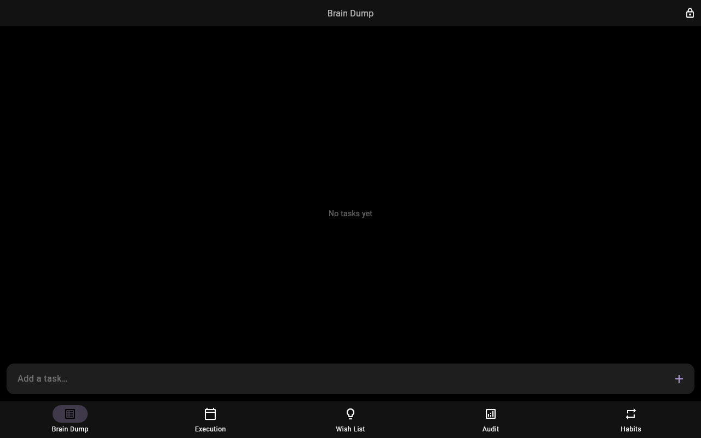
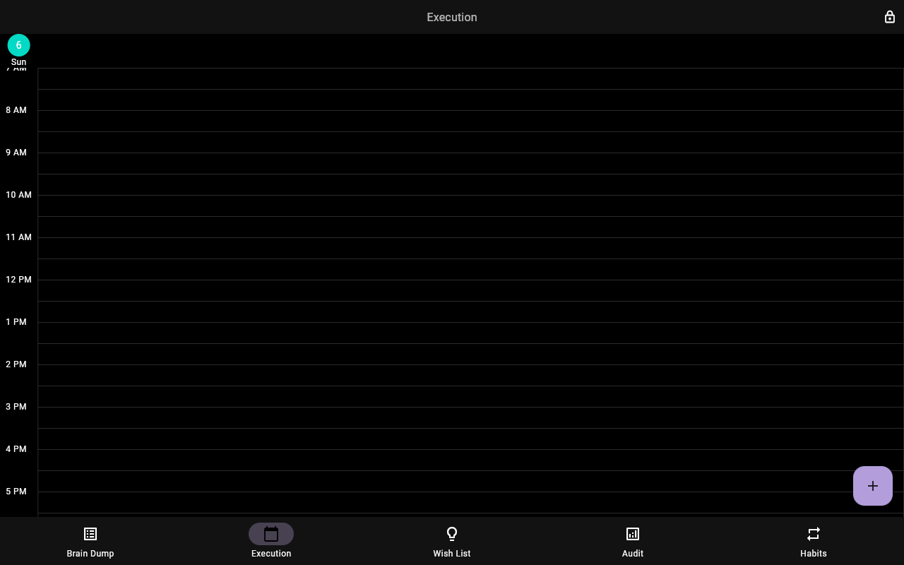
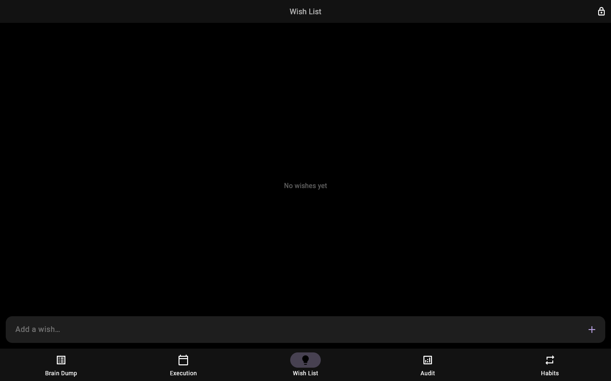
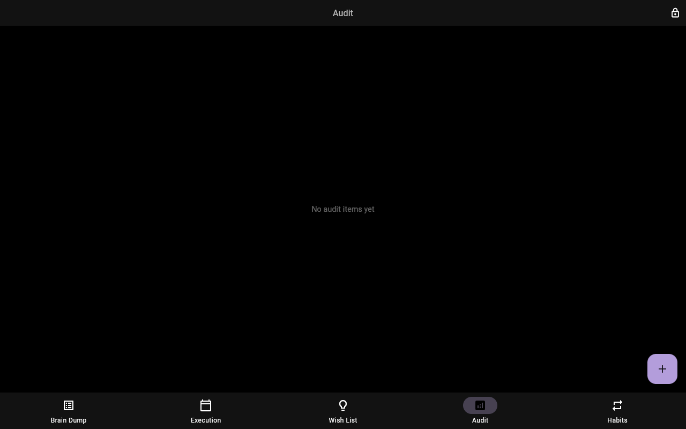
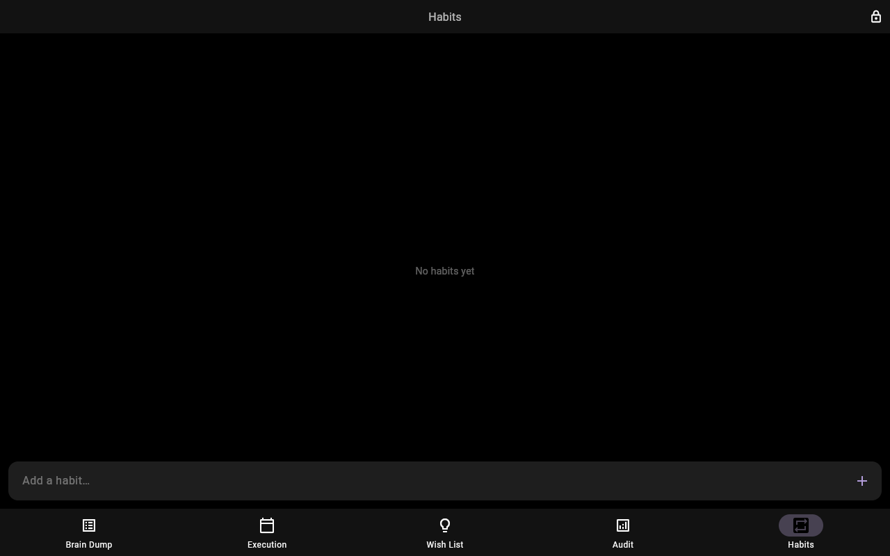

# Timeblock

Anti-distraction time-blocking PWA built with **Flutter Web** and **Firebase**. Unlock with a short PIN, capture tasks, drag them onto a day calendar, and track wishes, energy/value audits, and habits.

## Screenshots

| Login | Brain Dump | Execution |
| --- | --- | --- |
|  |  |  |

| Wish List | Audit | Habits |
| --- | --- | --- |
|  |  |  |

## Features

- **PIN unlock** — enter any 3 letters or digits; first use creates a profile, reuse loads the same data
- **Brain Dump** — capture daily tasks and cycle priorities
- **Execution** — day calendar with drag/resize time blocks
- **Wish List** — undated ideas
- **Audit** — energy × value matrix items
- **Habits** — habit definitions and today’s logs
- **Offline-friendly** — Firestore persistence with queued writes

## Tech stack

- Flutter Web (PWA)
- Firebase Auth (anonymous) + Cloud Firestore
- Riverpod + go_router
- Kalender (calendar UI)

## Run locally

Prerequisites: [Flutter](https://docs.flutter.dev/get-started/install) SDK (^3.12) and Chrome.

```bash
flutter pub get
flutter run -d chrome
```

On the login screen, enter any 3-character PIN (for example `DOC`).

Web Firebase options are already configured in `lib/firebase_options.dart` for project `daily-blocker-app`. Anonymous Auth and Firestore must be enabled on that Firebase project.

## Build for web

```bash
flutter build web
```

Output is in `build/web` (also deployable via Firebase Hosting — see `firebase.json`).

## Project layout

```
lib/
  main.dart
  firebase_options.dart
  router/                 # /login → /home
  core/                   # day selection, offline writes
  features/
    auth/                 # PIN unlock
    tasks/                # Brain Dump
    events/               # Execution calendar
    wishlist/
    audit/
    habits/
    shell/                # 5-tab home shell
```

## License

Private project unless otherwise noted.
